# VNDecorrelate
[](https://github.com/ckonst/VNDecorrelate/releases)[](https://pypi.org/project/vndecorrelate)[](https://github.com/ckonst/VNDecorrelate/actions/workflows/test-vnd.yaml)

A Velvet-Noise Decorrelator for audio.

Decorrelation refers to the process of transforming an audio source signal into multiple output signals with different waveforms from each other, but with the same sound as the source signal [[1]](#1).

In music production, decorrelation is typically applied to the left and right audio channels, creating the perception of stereo width and space. This, however, may come at the cost of potential coloration or transient smearing artifacts. 

Velvet-Noise Decorrelation (VND) attempts to minimize these artifacts as well as computation cost while reducing the correlation of the outputs as much as possible [[2]](#2).

VNDecorrelate implements the Velvet-Noise Decorrelator introduced by B. Alary,
A. Politis, and V. Välimäki in their 2017 paper, *Velvet-Noise Decorrelator* [[2]](#2).

## Quick Start

First install the package into your environment:
```pip install vndecorrelate```

Then load an audio file.

```python
import scipy.io.wavfile as wavfile
from vndecorrelate.decorrelation import *

fs, input_signal = wavfile.read("audio/viola.wav")
```

Then you can simply use the `VelvetNoise` class:

```python
velvet_noise = VelvetNoise(
    sample_rate_hz=fs,
    duration_seconds=0.03,
    num_impulses=30,
    log_distribution_strength=1.0,
)
output_signal = velvet_noise.decorrelate(input_signal)
```
Or:

```python
# manually generate the velvet noise as numpy NDArrays
velvet_noise = generate_velvet_noise(
    duration_seconds=0.03,
    num_impulses=30,
)
# numerically equivalent to VelvetNoise.convolve
output_signal = convolve_velvet_noise(input_signal, velvet_noise)
```

Or you can create a chain of signal processors:

```python
chain = (
    SignalChain(sample_rate_hz=fs)
    .velvet_noise(
        duration_seconds=0.03,
        num_impulses=30,
        log_distribution_strength=1.0,
        seed=1,
    )
    .haas_effect(
        delay_time_seconds=0.02,
        delayed_channel=1, # Right Channel
        mode='LR',
    )
)
# SignalChain is lazy, so instatiation of its signal processors happens here
output_signal = chain(input_signal)
```
To listen back to the processed audio, simply save to a wav file locally.

```python
wavfile.write('audio/viola_out.wav', fs, output_signal)
```

## Velvet Noise

Velvet Noise is a sparse noise sequence generated from randomly time-shifted impulses with a random value of either -1 or 1 [[2]](#2):

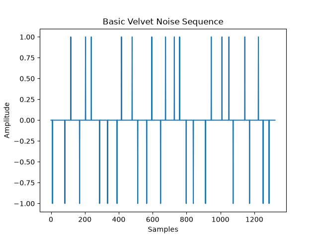

To reduce transient smearing and frequency coloration you can apply a segmented decay envelope [[2]](#2):

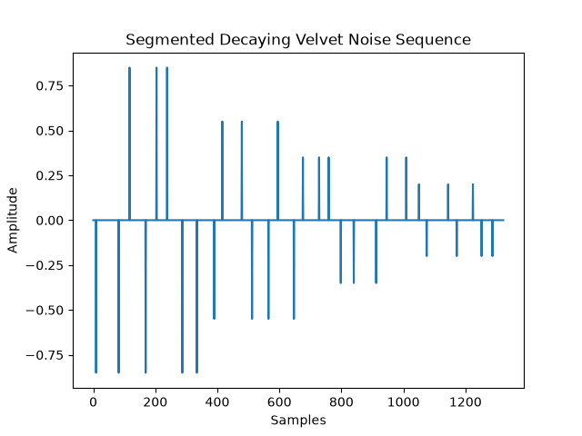

As well as logarithmically distribute the impulses towards the start of the sequence [[2]](#2):

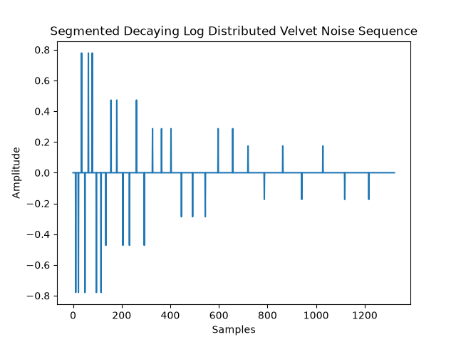

## Velvet Noise Convolution

The sparse velvet-noise convolution in Eq. (5) of the Velvet-Noise
Decorrelator paper [[2]](#2) is:

<picture><source media="(prefers-color-scheme: dark)" srcset="img/velvet-noise-convolution-dark.svg">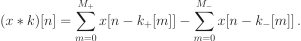</picture>

### Terms

- <picture><source media="(prefers-color-scheme: dark)" srcset="img/terms-dark.svg">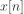</picture> is the input signal at sample index <picture><source media="(prefers-color-scheme: dark)" srcset="img/terms-2-dark.svg"></picture>.
- <picture><source media="(prefers-color-scheme: dark)" srcset="img/terms-3-dark.svg">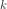</picture> is the sparse velvet-noise sequence (the convolution filter).
- <picture><source media="(prefers-color-scheme: dark)" srcset="img/terms-4-dark.svg">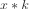</picture> is the output signal after convolution with <picture><source media="(prefers-color-scheme: dark)" srcset="img/terms-5-dark.svg"></picture>.
- <picture><source media="(prefers-color-scheme: dark)" srcset="img/terms-6-dark.svg">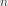</picture> is the output-sample index.
- <picture><source media="(prefers-color-scheme: dark)" srcset="img/terms-7-dark.svg">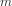</picture> is an index into a list of nonzero velvet-noise impulses.
- <picture><source media="(prefers-color-scheme: dark)" srcset="img/terms-8-dark.svg">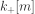</picture> is the sample location of the <picture><source media="(prefers-color-scheme: dark)" srcset="img/terms-9-dark.svg"></picture>th positive (<picture><source media="(prefers-color-scheme: dark)" srcset="img/terms-10-dark.svg">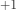</picture>) impulse.
- <picture><source media="(prefers-color-scheme: dark)" srcset="img/terms-11-dark.svg">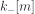</picture> is the sample location of the <picture><source media="(prefers-color-scheme: dark)" srcset="img/terms-12-dark.svg"></picture>th negative (<picture><source media="(prefers-color-scheme: dark)" srcset="img/terms-13-dark.svg">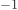</picture>) impulse.
- <picture><source media="(prefers-color-scheme: dark)" srcset="img/terms-14-dark.svg">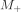</picture> and <picture><source media="(prefers-color-scheme: dark)" srcset="img/terms-15-dark.svg">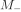</picture> are the upper summation limits for the positive- and negative-impulse location lists, respectively.

Separating positive and negative impulse locations lets an implementation use
only additions and subtractions for the nonzero filter coefficients; zero
coefficients are skipped.

### Segmented-Decay Convolution (Eq. 10)

With a segmented decay envelope, the paper groups the positive and negative
impulses by segment and scales each segment's partial sum:

<picture><source media="(prefers-color-scheme: dark)" srcset="img/segmented-decay-convolution-eq-10-dark.svg">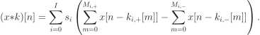</picture>

#### Additional Terms

- <picture><source media="(prefers-color-scheme: dark)" srcset="img/additional-terms-dark.svg">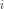</picture> is the segment index.
- <picture><source media="(prefers-color-scheme: dark)" srcset="img/additional-terms-2-dark.svg">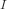</picture> is the last segment index.
- <picture><source media="(prefers-color-scheme: dark)" srcset="img/additional-terms-3-dark.svg">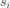</picture> is the decay coefficient applied to segment <picture><source media="(prefers-color-scheme: dark)" srcset="img/additional-terms-4-dark.svg"></picture>.
- <picture><source media="(prefers-color-scheme: dark)" srcset="img/additional-terms-5-dark.svg">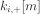</picture> and <picture><source media="(prefers-color-scheme: dark)" srcset="img/additional-terms-6-dark.svg">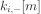</picture> are the locations of the positive and negative impulses in segment <picture><source media="(prefers-color-scheme: dark)" srcset="img/additional-terms-7-dark.svg"></picture>.
- <picture><source media="(prefers-color-scheme: dark)" srcset="img/additional-terms-8-dark.svg">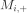</picture> and <picture><source media="(prefers-color-scheme: dark)" srcset="img/additional-terms-9-dark.svg">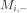</picture> are the upper summation limits for those two segment-specific impulse-location lists.

### Logarithmic Distribution Weights (Eq. 11, Repository Form)

Equation (11) is implemented by [`generate_log_distribution`](src/vndecorrelate/utils/dsp.py) as a sequence of exponentially increasing weights, rather than directly as a grid-size expression:

<picture><source media="(prefers-color-scheme: dark)" srcset="img/logarithmic-distribution-weights-eq-11-repository-form-dark.svg">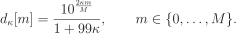</picture>

#### Terms

- <picture><source media="(prefers-color-scheme: dark)" srcset="img/terms-16-dark.svg">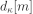</picture> is the unnormalized distribution weight at impulse index <picture><source media="(prefers-color-scheme: dark)" srcset="img/terms-17-dark.svg"></picture>.
- <picture><source media="(prefers-color-scheme: dark)" srcset="img/terms-18-dark.svg"></picture> is `log_distribution_strength`, in <picture><source media="(prefers-color-scheme: dark)" srcset="img/terms-19-dark.svg"></picture>.
- <picture><source media="(prefers-color-scheme: dark)" srcset="img/terms-20-dark.svg">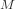</picture> is `size`, which is the number of impulses; the function returns <picture><source media="(prefers-color-scheme: dark)" srcset="img/terms-21-dark.svg"></picture> weights.
- At <picture><source media="(prefers-color-scheme: dark)" srcset="img/terms-22-dark.svg">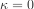</picture>, every weight is <picture><source media="(prefers-color-scheme: dark)" srcset="img/terms-23-dark.svg">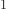</picture>, so the cumulative positions have equal increments. As <picture><source media="(prefers-color-scheme: dark)" srcset="img/terms-24-dark.svg">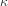</picture> increases, the exponential curve makes the weights smaller at early indices and larger at later indices. After normalization, the impulse locations therefore cluster toward the start of the filter, with progressively wider gaps toward its end.

### Randomized Logarithmic Locations (Eq. 12, Repository Form)

The repository first converts the weights into normalized cumulative sample locations, then adds the randomized offset:

<picture><source media="(prefers-color-scheme: dark)" srcset="img/randomized-logarithmic-locations-eq-12-repository-form-dark.svg">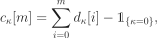</picture>

<picture><source media="(prefers-color-scheme: dark)" srcset="img/randomized-logarithmic-locations-eq-12-repository-form-2-dark.svg">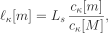</picture>

<picture><source media="(prefers-color-scheme: dark)" srcset="img/randomized-logarithmic-locations-eq-12-repository-form-3-dark.svg">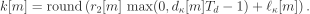</picture>

#### Additional Terms

- <picture><source media="(prefers-color-scheme: dark)" srcset="img/additional-terms-10-dark.svg">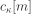</picture> is the cumulative distribution weight. The indicator <picture><source media="(prefers-color-scheme: dark)" srcset="img/additional-terms-11-dark.svg">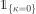</picture> reproduces the implementation's uniform-case off-by-one adjustment.
- <picture><source media="(prefers-color-scheme: dark)" srcset="img/additional-terms-12-dark.svg">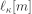</picture> is the cumulative location scaled to the FIR length.
- <picture><source media="(prefers-color-scheme: dark)" srcset="img/additional-terms-13-dark.svg">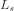</picture> is `fir_length_samples`, the total FIR length in samples.
- <picture><source media="(prefers-color-scheme: dark)" srcset="img/additional-terms-14-dark.svg">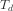</picture> is the average impulse interval (`sample_rate_hz / density`).
- <picture><source media="(prefers-color-scheme: dark)" srcset="img/additional-terms-15-dark.svg">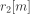</picture> is a uniform random value in <picture><source media="(prefers-color-scheme: dark)" srcset="img/additional-terms-16-dark.svg">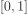</picture>.
- <picture><source media="(prefers-color-scheme: dark)" srcset="img/additional-terms-17-dark.svg">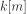</picture> is the rounded sample location of impulse <picture><source media="(prefers-color-scheme: dark)" srcset="img/additional-terms-18-dark.svg"></picture>.

`apply_log_distribution` implements the last expression. Although the helper builds <picture><source media="(prefers-color-scheme: dark)" srcset="img/additional-terms-19-dark.svg">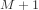</picture> values for normalization, the filter-generation loop uses the first <picture><source media="(prefers-color-scheme: dark)" srcset="img/additional-terms-20-dark.svg"></picture> locations, one for each impulse.

## Optimization

`optimization.py` searches for `VelvetNoise` or `HaasEffect` parameters that
maximize stereo separation while preserving polar-sample symmetry and mono
compatibility.

### Optimized Parameters

`optimize_velvet_noise` finds the `log_distribution_strength` that controls
how strongly impulses concentrate toward the start of the filter:

<picture><source media="(prefers-color-scheme: dark)" srcset="img/Kappa%20Dark.svg">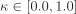</picture>

`optimize_haas_delay` finds the `delay_time_seconds` parameter:

<picture><source media="(prefers-color-scheme: dark)" srcset="img/Tau%20Dark.svg">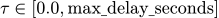</picture>

### Symmetry-Aware Objective

`symmetry_aware_objective` converts the decorrelated left and right channels
to polar samples and evaluates the following scalar objective:

<picture><source media="(prefers-color-scheme: dark)" srcset="img/Symmetry%20Aware%20Objective%20Dark.svg"></picture>

### Terms

- <picture><source media="(prefers-color-scheme: dark)" srcset="img/Alpha%20Dark.svg">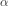</picture> is the scalar parameter being optimized.
- Each <picture><source media="(prefers-color-scheme: dark)" srcset="img/Moment%20Dark.svg">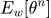</picture> is a moment of the polar-sample distribution.
- <picture><source media="(prefers-color-scheme: dark)" srcset="img/Weighted%20Angular%20Variance%20Dark.svg"></picture> is the weighted angular variance, which rewards stereo spread.
- <picture><source media="(prefers-color-scheme: dark)" srcset="img/Centroid%20Dark.svg">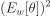</picture> is the weighted angular mean (centroid), penalized to keep the image centered.
- <picture><source media="(prefers-color-scheme: dark)" srcset="img/Skewness%20Dark.svg">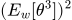</picture> is the weighted angular skewness, penalized to balance the left and right halves.
- <picture><source media="(prefers-color-scheme: dark)" srcset="img/R%20Dark.svg">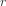</picture> is the correlation between the output left and right channels.
- <picture><source media="(prefers-color-scheme: dark)" srcset="img/Phi%20Dark.svg">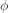</picture> is the angular constraint threshold.
- Each <picture><source media="(prefers-color-scheme: dark)" srcset="img/Lambda%20Dark.svg">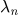</picture> is a penalty weight.

## Visualization

### Vectorscopes

Sample runs of `VelvetNoise.decorrelate` with unoptimized and optimized filters can be compared by their polar sample plots generated from `plot_polar_sample`:


`plot_polar_level`:


or `plot_lissajous`:


These vectorscope functions loosely follow the design of Izotope's Ozone Imager [[3]](#3), an industry standard stereo imager plugin for Digital Audio Workstations.

### Correlograms

To provide further visualization of the effects decorrelation `plot_correlogram` is provided. Short windows of typically ~20ms are taken from two signals to calculate normalized cross-correlation values at various lag distances. `sine_sweep` can be used to generate a test signal that can be compared before and after applying a velvet noise decorrelation.

We can use the auto correlogram as a baseline:

Plot the cross correlogram after filtering each channel with velvet noise:

And compare to the behavior of filtering with white noise:


## References
<a id="1"> </a>
  [[1]](https://www.sweetwater.com/insync/decorrelation/) Sweetwater, “Decorrelation,” *InSync*, Dec. 17, 2004. https://www.sweetwater.com/insync/decorrelation/ (accessed May 15, 2026).


<a id="2"> </a>
  [[2]](http://www.dafx17.eca.ed.ac.uk/papers/DAFx17_paper_96.pdf) B. Alary, A. Politis, and V. Välimäki, “VELVET-NOISE DECORRELATOR,” *Proceedings of the 20th International Conference on Digital Audio Effects (DAFx-17)*, Edinburgh, UK, Sep. 2017. Accessed: May 15, 2026. [Online]. Available: http://www.dafx17.eca.ed.ac.uk/papers/DAFx17_paper_96.pdf


<a id="3"> </a>
[[3]](https://downloads.izotope.com/docs/ozone8/imager/index.html#vectorscope) “Ozone 8 Help Documentation,” Izotope.com, 2017. https://downloads.izotope.com/docs/ozone8/imager/index.html#vectorscope (accessed Jun. 15, 2026).
